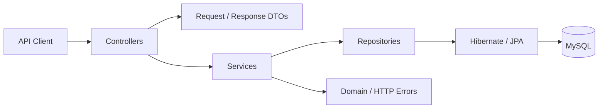

# Commerce Backend

> A clean REST API built to master backend engineering with Java, Spring Boot, Spring Data JPA, and MySQL.


Commerce Backend is a layered API for managing products and categories. It moves beyond basic CRUD to demonstrate validation, entity relationships, DTO-based contracts, pagination, search, custom JPQL, lazy loading, fetch joins, centralized error handling, health monitoring, and an efficient development workflow.

## Highlights

- Complete product create, read, update, and delete workflow
- Category creation and retrieval with duplicate-name protection
- Many-to-one relationship between products and categories
- Request validation with clear field-level errors
- Domain-specific `404 Not Found` handling
- Filtering by category and minimum price
- Case-insensitive, partial-name product search
- Database-level pagination and sorting
- Detailed product responses with category information
- Lazy-loading and fetch-join examples
- MySQL persistence through Spring Data JPA and Hibernate
- Spring Boot Actuator health monitoring
- Spring Boot DevTools automatic development restarts
- Maven Wrapper and application-context smoke testing

## Architecture



```text
src/main/java/com/dennymathew/commercebackend
├── controller/   HTTP endpoints and DTO mapping
├── dto/          Request and response contracts
├── entity/       JPA persistence models
├── exception/    Domain errors and validation handling
├── repository/   Database access and custom queries
└── service/      Business rules and transaction boundaries
```

Each layer has one job: controllers speak HTTP, services coordinate business behavior, repositories handle persistence, DTOs define the public contract, and entities model stored data.

## API reference

Base URL: `http://localhost:8080`

### Products

| Method | Endpoint | Description |
|---|---|---|
| `POST` | `/api/products` | Create a product, optionally linked to a category |
| `GET` | `/api/products` | List products with pagination and sorting |
| `GET` | `/api/products/{id}` | Retrieve one product |
| `PUT` | `/api/products/{id}` | Update a product |
| `DELETE` | `/api/products/{id}` | Delete a product |
| `GET` | `/api/products/category/{categoryId}` | List products in a category |
| `GET` | `/api/products/above-price?price=500` | Find products above a price |
| `GET` | `/api/products/search?name=phone` | Search by partial name with pagination |
| `GET` | `/api/products/details` | Load products and categories using a fetch join |
| `GET` | `/api/products/details-lazy` | Map lazy relationships inside a read-only transaction |

Spring's standard pagination parameters are supported:

```http
GET /api/products?page=0&size=10&sort=price,desc
GET /api/products/search?name=phone&page=0&size=5&sort=name,asc
```

### Categories

| Method | Endpoint | Description |
|---|---|---|
| `POST` | `/api/categories` | Create a unique category |
| `GET` | `/api/categories` | List all categories |
| `GET` | `/api/categories/{id}` | Retrieve one category |

### Operations

| Method | Endpoint | Description |
|---|---|---|
| `GET` | `/actuator/health` | Check application health |

## Request examples

Create a category:

```bash
curl -X POST http://localhost:8080/api/categories \
  -H "Content-Type: application/json" \
  -d '{"name":"Electronics"}'
```

Create a product:

```bash
curl -X POST http://localhost:8080/api/products \
  -H "Content-Type: application/json" \
  -d '{"name":"Mechanical Keyboard","price":7499.00,"categoryId":1}'
```

Example response:

```json
{
  "id": 1,
  "name": "Mechanical Keyboard",
  "price": 7499.0,
  "categoryId": 1
}
```

Invalid input produces field-level errors:

```json
{
  "name": "must not be blank",
  "price": "must be greater than 0"
}
```

## Run locally

### Prerequisites

- Java 21 or newer
- MySQL 8 or newer
- Git

Maven does not need to be installed globally; the repository includes Maven Wrapper.

### 1. Clone

```bash
git clone https://github.com/DennyM55/commerce-backend.git
cd commerce-backend
```

### 2. Create the database

```sql
CREATE DATABASE commerce_db;
```

### 3. Configure the connection

Update `src/main/resources/application.yaml` for your local MySQL instance:

```yaml
spring:
  datasource:
    url: jdbc:mysql://localhost:3306/commerce_db
    username: your_username
    password: your_password
```

Use environment variables or a secrets manager for credentials outside local development.

### 4. Start the API

Windows:

```powershell
.\mvnw.cmd spring-boot:run
```

macOS or Linux:

```bash
./mvnw spring-boot:run
```

The API starts on `http://localhost:8080`. DevTools restarts the application when compiled code changes.

### 5. Run tests

Windows:

```powershell
.\mvnw.cmd test
```

macOS or Linux:

```bash
./mvnw test
```

## What this project teaches

### 1. Build APIs around contracts

Java records provide concise request and response DTOs. They prevent persistence internals from leaking into the public API and allow the database model to evolve independently.

### 2. Separate responsibilities

Controllers handle transport concerns, services apply business rules, repositories access data, and entities represent persistent state. Constructor injection keeps those components explicit and testable.

### 3. Validate at the boundary

Jakarta Validation rejects bad input before it reaches business logic. A global exception handler converts validation failures into consistent `400 Bad Request` responses.

### 4. Model relationships deliberately

The `Product` to `Category` many-to-one association demonstrates foreign keys, optional relationships, category existence checks, and the difference between API models and database entities.

### 5. Understand lazy loading and N+1 queries

Lazy relationships require an active persistence context when accessed. This project contrasts two valid approaches:

- Map lazy relationships within a read-only transaction.
- Fetch the required relationship explicitly with `LEFT JOIN FETCH`.

The second approach is useful when an endpoint needs a known object graph without triggering one additional query per row.

### 6. Choose the right query tool

- `JpaRepository` supplies standard CRUD operations.
- Derived query methods express readable searches such as `findByNameContainingIgnoreCase`.
- JPQL provides explicit filtering and fetch behavior.
- `Pageable` adds database-level pagination and sorting without custom plumbing.

### 7. Design collection endpoints to scale

Product listing and search return `Page<T>`, providing content, page number, size, total elements, total pages, and navigation metadata while avoiding full-table reads.

### 8. Treat developer experience as engineering

Maven Wrapper makes builds reproducible, DevTools shortens the feedback loop, Actuator exposes health information, and the test suite verifies that the Spring application context starts successfully.

## Technology stack

| Area | Technology |
|---|---|
| Language | Java 21 |
| Framework | Spring Boot 4.1 |
| Web | Spring Web MVC |
| Persistence | Spring Data JPA and Hibernate |
| Database | MySQL |
| Validation | Jakarta Bean Validation |
| Monitoring | Spring Boot Actuator |
| Development | Spring Boot DevTools and Lombok |
| Build | Maven Wrapper |
| Testing | Spring Boot Test |

## Next milestones

The current foundation is ready for production-focused extensions:

- JWT authentication and role-based authorization
- Flyway or Liquibase database migrations
- Testcontainers repository integration tests
- Focused controller and service tests
- OpenAPI/Swagger documentation
- Docker and Docker Compose support
- Environment-specific Spring profiles
- Structured error responses with request metadata
- Continuous integration for build, tests, and quality checks

## Author

Built by [Denny Mathew](https://github.com/DennyM55) as a hands-on exploration of clean Spring Boot backend development.
